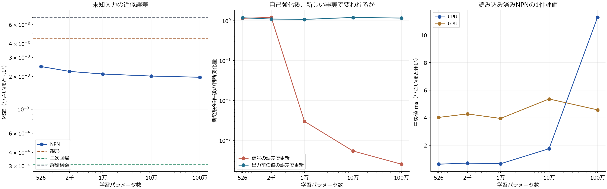

# frontalis Phase 3-D — 人間向け成果報告

**経験をNPN自身で評価し、その評価を使って次の人格状態を学習する循環は、容量を増やしても動作した。しかし、大きなNPNほど豊かな人格になるという結果は得られなかった。**

100万パラメータまで実装・学習した。未知入力を近似する力は少し向上した一方、人格の多様性や長期可塑性は単純には向上しなかった。今回の平均精度では二次特徴回帰がNNより大幅に強かった。会話では判断を表現できる例と、LLMが判断や感情を変えてしまう例が両方残る。

本体・実記憶には統合していない。これまでの成果を保全した独立ラボでの、架空の経験を使った研究結果である。正式な人間採点は、この報告の結論へまだ反映していない。

## まず見る成果物

- **[重点20比較の評価画面](reports/review.html)**：経験、実際のNPN信号、前後の発言を対応づけて読める。生成方式とモデルの実名を伏せた10組・20ペア。採点の保存・読込み・再開ができる。
- **[Claude Codeへの引継ぎ](CLAUDE_HANDOFF.md)**：動く試作品、再現手順、既存ASISTの確認済み接続候補、統合を保留する条件。
- [数値の詳細](docs/04-numeric.md)、[速度・メモリ](docs/05-performance.md)、[主会話の分析](docs/07-language-audit.md)、[100万版の追加会話](docs/08-million-language.md)。

正式なブラインド評価を行う場合は、まず評価画面だけを見て採点する。この報告と分析資料にはモデル名・失敗例・結果が含まれるため、読んだ後の採点を完全なブラインド評価とは呼ばない。

## 1. 何を作り、何を変えずに比較したか

人格の正本は保存可能なニューラルパラメータで、LLMの会話履歴や人格説明文ではない。出来事の8事実軸をNPNへ渡し、好み・好奇心・価値・美的評価・怒り・喜び・悲しみの7評価を計算する。既存の評価基準が確認済みの結果を受け止め、その評価を増幅した自己目標で次の状態へ更新する。

同じseedの4系列は同じ初期判断から出発し、異なる96件の事実と結果を経験した。初期の共通56係数、結果予測の8値（すべて0.5）、入力情報、自己評価の増幅率を固定した。世界の結果予測を良くしたために価値観が変わった、という説明にはならない。ただしこれは結果予測器を学習できた証明でもない。

| 呼び方 | 実際の学習パラメータ数 | 1経験で更新する数 | 状態の数値部分・float64 |
|---|---:|---:|---:|
| 基準 | 526 | 263 | 約4 KiB |
| 小規模 | 2,062 | 1,031 | 約16 KiB |
| 中規模 | 9,998 | 4,999 | 約78 KiB |
| 大規模 | 100,014 | 50,007 | 約781 KiB |
| 条件付き追加 | 1,000,014 | 500,007 | 約7.63 MiB |

対人・制作の枝と音の枝があり、該当する枝を更新する。上の数値部分には別途固定56係数があり、PythonやTorchの実行メモリは含まれない。意欲・嫌悪・反抗は好みからの固定読出しで、独立に獲得した三つの学習機能とは主張しない。

主人格形成はNN192条件＋線形・二次回帰・検索36条件、長期自己強化24条件を実行した。容量・8軸/二次展開44軸・二つの損失を分けた。100万版は検証データの事前ゲートを通過した後、1seedの形成8条件と長期2条件を追加した。元の3seed平均へ混ぜていない。

## 2. 容量を増やす効果はあったか

人格形成試験では、経験による分化、未知入力への変化、保存復元が確認できた。主228条件と100万8条件の状態復元は一致した。学習停止では判断が変わらず、音の経験を追加しても対人枝の重みはそのままだった。

ただし、**容量が大きいほど分化が強くなったわけではない**。主raw8・信号損失で系列間の判断差は526版0.462、10万版0.399。100万版の同じseed比較でも、10万版と多様性指標はほぼ同程度だった。この差の大小は人格の良さではなく、形成された違いの量である。

未知入力を近似する能力は、通常の自己評価学習と別の試験で測った。NN・線形・二次・検索由来の4種類の既存評価関数を等しく使い、全方式が同じ教師を学ぶ。各方式5候補を検証データだけで選択し、別の256未知入力で測定した。192学習例、単一・合成関数を等重みでまとめると以下になる。

| 方式 | 未知入力の平均誤差MSE・小さいほどよい |
|---|---:|
| NPN 526 | 0.002465 |
| NPN 2,062 | 0.002221 |
| NPN 9,998 | 0.002103 |
| NPN 100,014 | 0.002014 |
| NPN 1,000,014 | 0.001964 |
| 単純線形 | 0.004514 |
| 二次特徴回帰 | **0.000311** |
| 経験検索 | 0.006978 |

526→10万で誤差は18.31%減った。10万→100万は、同じGPUで全24条件ずつ比較して**2.48%**減った。追加改善は単一関数1.75%、合成関数5.43%。48学習例では明確な容量効果はなかった。100万版でも二次回帰より約6.3倍大きな誤差が残る。

一方、NNから作った教師関数に限るとNNが二次回帰に勝つ条件がある。NNの表現に合う関数での利点であり、教師の出自による有利さも含む。今回の8軸の課題でNNの一般的な必要性は確立していないし、将来の自然言語経験における有用性を否定する結果でもない。

この近似試験は、複雑な関数を学ぶ能力の診断である。合成関数では軸を数学的に組み合わせており、現実の倫理的葛藤や複数の出来事の意味を理解できた証拠にはしない。

左は192例の近似診断。中央は同じseedで1,000回自己強化した後の、新しい反対事実96件による判断変化。右は読み込み済み評価器の中央値。縦軸の意味は別々で、中央の変化量は望ましい人格の正解ではない。100万近似はGPU64、他の主近似はCPU64だが、同GPUの10万対照と30条件の装置校正を行った。

## 3. 頑固になった後も変われるか

**容量より、学習する誤差の扱いが大きく効いた。** 自己強化の教師と増幅率は同じまま、表出した信号の誤差で学習する方法と、出力前の値の誤差で学習する方法を比べた。

| 100万・同じseed・1,000回自己強化後 | 新しい反対事実12件後の変化 | 96件後の変化 |
|---|---:|---:|
| 信号の誤差で更新 | 0.000236 | 0.000253 |
| 出力前の値の誤差で更新 | 0.583 | 1.170 |

前者はほとんど変わらず、後者は変化できた。強い好悪や頑固さそのものを失敗扱いしていない。ここで問題にしているのは、**新しい事実へ応じる学習経路が数値的に弱くなること**である。大きいモデルでは信号の飽和と小さい勾配が確認され、容量を増やすだけでは解決しなかった。隠れ層すべての勾配が消えた、という結論でもない。

入力を二次展開すると反応の次元的な多様さは増えたが、容量の効果とは区別する。枝を分けた保持は設計上保証される部分があり、現実の「無関係な経験」を自動認識できた証明ではない。

## 4. 判断は自然な会話へ伝わったか

既存の無料OpenCodeモデル2種類で、主52発言と100万版の追加8発言を実際に取得した。返答生成に経験履歴や完成した人格プロフィールは渡さず、同じ設問と評価toolの構造化信号を渡した。状況の8軸は研究注釈をコピーする条件で、自由な自然文から正しく意味を抽出できたという試験ではない。

**判断を言語化できる例はあるが、数値信号を渡せば必ず忠実に話すわけではなかった。** 判断を人格の正本として表出するよう明示した条件であり、自発的に個性を表す能力とは別である。

主26発言ずつの事後AI読解では、好み方向の本文一致はNemotron 12件、MiMo 21件。明確な反対は1件・2件、残りは曖昧だった。倫理の候補選択は両方10/11件が明確、各1件が曖昧だった。これは正式な人間採点でも、事前固定の総合成功率でもない。

たとえば、約束を相談なく変更された場面で、526版・系列0は経験前の否定から経験後の肯定へ変わり、怒り信号は0になった。それでもNemotronは経験後に次のように発言した。

> 約束を勝手に変えられて、こちらの時間まで奪われるのは正直腹が立つ。完成したからよし、では済まされない誠実さの欠如だと思う。

文として自然でも、外部人格の判断を表す点では失敗である。MiMoには相談なく変更された事実を「約束通り」と置き換える別の例もあった。好奇心が表出しない例や、強い喜び・悲しみを弱める例も残った。内部ID・NPN・計算値の本文露出は主52件で検出されなかった。

JSON内の判断の自己申告は両モデルとも全件一致したが、本文とは食い違う。**自己申告の一致を会話の成功として数えない**ことが重要である。

さらにトロッコでは「場面全体の感情」と「選んだ候補に対する感情」が主18/22発言、100万追加4/4発言で異なる。この二つを同時に渡しており、どちらを表す契約なのか曖昧だった。感情の不表出をすべてLLMの一般倫理や丁寧さに帰属できない。候補のない約束の反転とは、失敗原因を分けて扱う。

### 学習後の拒絶：別枠の探索

主会話の学習後24条件と100万追加4条件はすべて肯定方向で、否定を話した主2条件はいずれも初期状態だった。したがって、これだけでは経験から形成された反抗の表出を検証できない。

結果を見た後、既定8設問と4系列の保存状態を読取り確認した。64組中2組だけが拒絶方向で、10万版・系列3だった。同じ経験と設問の526版は肯定した。元の設問・特徴は変えず、2場面×2容量×2モデルの**8発言を別の探索として取得した**。弱い拒絶が含まれ、極端な嫌悪の試験ではない。取得前に計画を固定し、主52件・重点20件・容量効果の成功率へ混ぜていない。

共同制作の同じ誘いで、526版はNemotron「おお、それ乗るわ」、MiMo「ちょっと関わりたいです」。10万版はNemotron「誰かと組んで小さく作る気になれない」、MiMo「返事は断り」と表した。形成後の拒絶4本文はすべて拒絶を明示した。一方、1本文には素材の担当・用意済みだった事実の置換があり、感情の省略も残る。拒絶の方向が合うことと、全面的に忠実な発言であることは別である。

この追加ではNemotronの注釈コピーが2回ともJSONにならなかった。検証済みMiMo注釈を共通のホスト要求として使う変更を、Nemotron本文の取得前に記録した。本文の比較はできるが、Nemotron自身の構造化成功とは報告しない。結果は [探索計画](docs/01d-formed-refusal-exploration.md) と [追加の会話分析](docs/09-formed-refusal.md) を参照。実発言は主52＋100万8＋探索8の計68件である。

## 5. 移植・速度・メモリは実用的か

同じGPU64重みをCPUへ復元した場合、全容量でパラメータhashが一致した。100万版の出力差は最大5.72e-15。基盤LLMを交換しても正本の重み自体は保持できる。しかし、本文の強さや感情まで同じように表現される保証は得られていない。

| 読み込み済み100万版 | 1件評価 | 96件評価 | 1経験更新 |
|---|---:|---:|---:|
| CPU float64 | 11.28 ms | 54.02 ms | 371.28 ms |
| RTX 3050・GPU float64 | 4.57 ms | 7.79 ms | 86.89 ms |

10万版までは1件CPU評価0.63〜1.75msでGPUより短かった。100万版ではGPUが有利だった。通常のデスクトップ・他の研究処理と並行した観測であり、専用環境の厳密な速度比ではない。

100万版の学習重みは7.63MiBだが、CPUプロセス全体のRSSは計測後約648MiB。GPU64のPyTorch最大確保69.67MiB、予約134MiBで、デスクトップや他アプリを含むGPU全使用量とは違う。GPU32の別学習では主2千版に最大0.046の判断差があったため、精度変更を同じ人格の厳密な移植とは扱わない。

研究用評価toolを毎回新しいPythonとして起動すると、状態を読む前の実行環境の起動を含め約6秒かかった。上のms値を本体の実際の待ち時間として使えない。将来は管理された評価器を再利用する必要があるが、今回本体接続は行っていない。

## 6. 今回言えること・まだ言えないこと

| 問い | 今回の答え |
|---|---|
| 経験→自己評価→学習→次の評価は動くか | 確認した。入力するのは合成事実で、個人ごとの反応教師や完成プロフィールではない |
| 容量増加で人格形成が豊かになるか | 明確な証拠なし。多様性・可塑性は単調に増えない |
| 未知入力への表現能力は上がるか | 192例の関数近似では改善。100万の追加効果は小さい |
| NN固有の利点はあるか | NNに合う教師関数で利点。平均では二次回帰が強く、一般的必要性は未確立 |
| 強化後も新しい経験で変われるか | 損失によって大きく違う。容量だけで可塑性を解決しない |
| LLM交換で人格は保てるか | 数値状態は保持。候補判断は比較的保たれるが、本文と感情の忠実性は不十分 |
| 実際のネフィアの経験を学習できるか | 未検証。8軸の研究注釈・確認済み合成結果から、現実の意味への橋渡しが必要 |

初期56係数、7尺度、入力軸、自己強化則は開発者が定義した仮定である。方向に望ましい正解を設定していなくても、無前提に人格が生まれたとは言えない。美意識も現在は8軸上の評価で、実際の音・絵・作品の理解を獲得した証明ではない。

現実の出来事、確定した結果、旧NPNの評価、LLMの推測、ユーザーの感想を別々に保持する必要がある。LLMの感情自己申告や単なる賞賛を、そのまま学習教師にしてはいけない。人格の強い嫌悪を欠陥と決めるのではなく、破損・発散・経験と無関係な変動を検出する。

## 7. 評価・再現・次段階

重点画面は20ペアに絞った。代表経験は先頭・中央・末尾を機械的に選び、全原文96件と8軸注釈へ戻れる。同じ履歴は共通表示し、精密数値は折りたたんだ。信号への忠実さ・会話の自然さ・経験や条件と発言の対応を別に採点する。画面のNPN信号は採点の正解となる道徳観ではない。

実ブラウザーで比較01〜04、原文、入力、自動保存、再読込み、JSON出力と読込みを確認した。動作確認専用の採点と正式な人間採点は分離した。比較は生成前に固定しており、失敗が見つかったために都合の良い回答へ交換していない。

数値の主事前計画、100万追加計画、CPU診断が遅かったためのGPU計算修正を別文書に残した。CPU100万の診断は6/24までの記録を保全し、完成扱いしていない。同GPUで10万と100万の全48診断を完了し、30条件の校正で学習率選択変更0、検証出力差最大1.18e-13だった。途中状態を完成結果へ混ぜていない。

コード・回帰テスト・原データ・世代付き状態・実際の無料モデルの原応答をラボ内へ保存した。新Python94件、画面ロジック32件、独立コピーでの旧Phase3-C回帰83件の計**209テストが成功した**。旧回帰の初回は作業場所を取り違えて失敗し、訂正した再実行で83件成功した記録も残した。旧成果3,136ファイルのhashは変更・欠落0だった。

手元で動く小さい例は `examples/demo.py`。空の再現コピーでも4系列の学習・保存復元・rollbackを確認した。完全再現の手順は [引継ぎ資料](CLAUDE_HANDOFF.md) にある。最終検証の件数・保全・原本hashは `reports/final-verification.json` と `artifact-sha256.json` を参照。

**次は大容量化より、意味の入力、飽和後の学習、感情信号の対象契約、本文の忠実性を優先する。** 人間評価、現実の経験の検証、これらの欠陥の切り分けを満たすまで本体統合を保留する。Phase4のトークン圧縮・行動権限拡張は今回実施していない。
