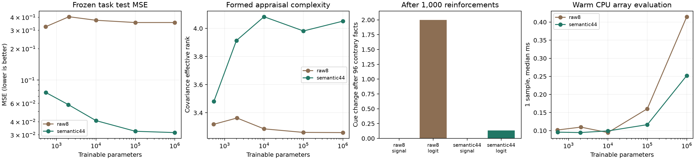

# frontalis Phase 3-E — 実装・実測結果

**自然文の意味を受け取り、既存NPNが評価して自己学習し、次の経験への判断を変える経路を実装・実動確認した。意味を増やすと文脈による判断差が生じた。一方、豊かな入力の長期可塑性と、本文の忠実性には未達が残る。**

## すぐ使う

- 実行用画面：`http://127.0.0.1:8903/`。容量5段階、意味44／事実8、初期／形成済み、経験の解釈・自己学習・言語化・保存復元・ZIP出力。起動は `./start-workbench.ps1`。
- 通信なしのデモ：`examples/offline_demo.py`。保存済み4個体は `examples/demo-output/`。
- 人間用46比較：`reports/review.html`。実会話92発言。正式な人間採点は未実施。動作確認の採点は未採点へ戻した。
- 実装は `npne/`、読み取り専用toolは `tools/evaluate.py`、再現手順は `CLAUDE_HANDOFF.md`。本体・実記憶・既存設定は変更していない。

## 完了した比較

主形成240個体×48経験、学習off30対照、長期60個体×1,096経験、凍結関数近似144条件を完了。全主形成で有限・保存復元一致、別分枝保持、中立経験不変を確認。主形成の平均履歴間差は 0.295。初期56係数と評価軸・自己強化則は設計上の仮定である。

| 入力 | 容量 | 未知関数MSE | 文脈感度 | 有効ランク |
|---|---:|---:|---:|---:|
| raw8 | 526 | 0.323860 | 0.000 | 3.318 |
| raw8 | 2,062 | 0.404093 | 0.000 | 3.363 |
| raw8 | 9,998 | 0.373792 | 0.000 | 3.286 |
| raw8 | 100,014 | 0.355633 | 0.000 | 3.261 |
| raw8 | 1,000,014 | 0.355647 | 0.000 | 3.259 |
| semantic44 | 534 | 0.076162 | 0.147 | 3.482 |
| semantic44 | 1,990 | 0.058264 | 0.151 | 3.914 |
| semantic44 | 9,998 | 0.040991 | 0.127 | 4.083 |
| semantic44 | 100,062 | 0.032406 | 0.099 | 3.982 |
| semantic44 | 999,974 | 0.031483 | 0.099 | 4.052 |

意味44の534→10万でこの固定課題のMSEは57.5%改善、10万→100万は2.8%改善。意味44の線形ridgeは0.032462、二次ridgeは0.036417、検索は0.187777。10万NNは線形とほぼ同等。教師は44要素を使う合成関数なので、8軸側には設計上の情報欠落がある。容量の一般的優越や人格の良さの証明ではない。

## 自然文からの学習

32文は8話型×4表現。研究者作成の架空注釈との比較であり、32独立状況や人間の唯一の解釈ではない。

| 抽出モデル | schema成功 | カテゴリ一致 | 8軸MAE | 事前基準 |
|---|---:|---:|---:|---|
| mimo-v2.6-flash-free | 87.5% | 86.8% | 0.2852 | 未達 |
| nemotron-3-ultra-free | 37.5% | 36.6% | 0.6875 | 未達 |
| claude-haiku-5-5 | 100.0% | 99.0% | 0.0625 | 達成 |

Haikuの追加はユーザー承認後の別群。OpenCodeのタイムアウト・tool使用・欠測を置き換えて成功扱いしていない。Haikuは15経験を全件学習できたが、正解意味で学んだ個体との未知入力判断差MAEは534版0.380、10万0.318、100万0.251。抽出精度の高さだけで、学習後の判断まで同一になるとは言えない。未学習の意味はheldout8件中3話型に限られ、他は未知の言い換え。

## 長期可塑性：主実験は未達、追加で経路を切り分けた

主条件の『反対経験後>.05かつlogit法がsignal法より大きい』は53.3%で、事前80%基準は未達。raw8は15/15、意味44は1/15。raw8の大きな変化も、遠い同分枝への大きな波及を伴い、局所的な価値更新の成功とは言えない。

事後に計画・凍結した結果評価の文脈分離は6/6で暫定基準を通過。cueの意味は保ち、結果評価の末尾36要素だけを中立化した。望ましい感情の教師は追加していない。関係性・意図を結果評価から除く制約があり、遠い判断への変化も残る。2容量・3seedだけの追加探索で、主実験の結果へ混ぜない。画面で探索方式として選択できる。

## 言語と実装の限界

主会話72/72、自然文接続20/24を取得。取得92件のJSON stance・候補選択は一致したが、MiMoには怒り信号0でも「怒りはある」と表す例、Nemotronには喜び信号0でも「嬉しい」と表す例がある。実行用画面の追加試験にも感情の付加があった。主会話の候補選択は24条件ともBで、候補分化や広い倫理判断の実証にはなっていない。本文の忠実性・自然さ・事実保持は正式な人間評価を待つ。詳細は `reports/failure-cases.json`。

意味schemaは最大2出来事・固定行為分類・限定した関係性で、任意概念や長い経験列の一般的な意味理解は未実証。別分枝保持は構造による保証で、同分枝の無関係な価値保持は未解決。本体統合は別判断とする。

## 実行コスト・検証

| 意味44 | CPU評価1件ms | CPU更新ms | GPU更新ms | 重みbytes |
|---:|---:|---:|---:|---:|
| 534 | 0.096 | 6.41 | 33.39 | 4,720 |
| 1,990 | 0.095 | 6.11 | 30.28 | 16,368 |
| 9,998 | 0.099 | 7.50 | 35.42 | 80,432 |
| 100,062 | 0.116 | 13.63 | 33.84 | 800,944 |
| 999,974 | 0.252 | 106.01 | 50.42 | 8,000,240 |

読み込み済み配列APIのwarm値で、tool起動・LLM待機は含まない。RSS/privateとCUDA allocatorの全記録は `reports/performance.json`。同GPU重みのCPU復元は全10条件でhash一致、最大出力差 1.39e-15。4回の別学習校正から1000回の軌道一致は主張しない。

新実装34テスト、独立コピーで旧94回帰テストが成功。事前凍結18ファイルの変更0、旧成果6,618ファイルの変更・欠落0。実画面で2経験の学習、言語化、前後世代の復元を確認し、人間評価画面の自動保存・JSON保存読込も確認した。再現用数値、重み、原応答、失敗、hash台帳を保存した。
