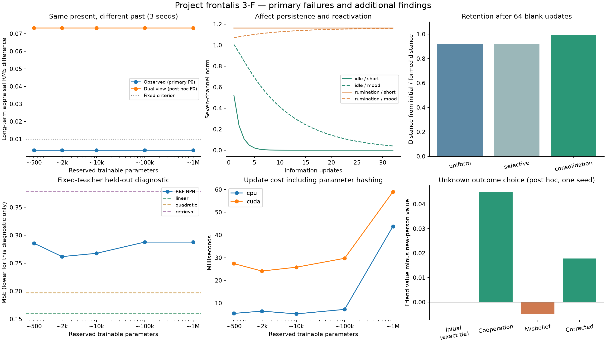

# Project frontalis — Phase 3-F 成果報告

時間・一時感情・気分・長期人格・経験記録を分けた研究実装と、5容量の再現実験を作成した。主条件では時間分離と学び直しが成立した一方、同じ現在への長期的な過去差は事前基準を満たさなかった。独立した二視点方式で改善したが、容量に伴う人格の複雑化は今回の系列では実証できていない。

## 使える成果物

- [ワークベンチ起動](start-workbench.ps1) → http://127.0.0.1:8905/ 。経験の反復、時間経過、反すう、訂正、自然文の型付き抽出、確認後の学習、言語化、人格ZIP保存。主方式と二視点の追加方式を明示して選べる。
- [NPN実装](npnf/core.py)、[二視点方式](npnf/dual_view.py)、[独立評価ツール](tools/evaluate.py)、[二視点ツール](tools/evaluate_dual.py)、[API不要デモ](examples/offline_demo.py)。
- [主数値結果](reports/numerical-analysis.json)、[追加結果](reports/extended-analysis.json)、[16組の対話型比較](reports/dashboard.html)、[主会話72件](reports/conversation-analysis.json)、[追加会話80件](reports/additional-conversations.json)、[実ツール往復10件](reports/actual-tool-calls.json)。
- [主会話の匿名評価44対](reports/review.html) / [追加会話40対](reports/additional-review.html)。正式な人間採点は未実施。機械の点数を人間評価へ転記していない。
- [原方式の6段階会話](reports/workbench-conversation.json)、[二視点の6段階会話](reports/workbench-conversation-dual.json)、[保存した二視点人格](reports/workbench-live-dual-personality.zip)、[Claude Code引継ぎ](CLAUDE_HANDOFF.md)。

## 主条件と独立した追加条件

[事前計画](PREREGISTRATION.md)と18ソースを最初の本数値実験前に固定。seedは6311/6312/6313。4つの数値初期傾向を用い、人物名やその説明を言語化LLMに与えない。言語入力の実験IDには状態名が含まれたため、状態名からの推測の影響を完全には除けていない。

| 主条件の判定 | 結果 |
|---|---|
| 16更新後の短期感情 < 直後の1% | 240/240 |
| 同時点の気分 < 直後の50% | 240/240 |
| 長期の形成効果を50%以上保持 | 240/240 |
| 同じ現在への長期的な過去差 >0.01 | 0/60群、失敗 |
| 反復後64経験で変化>0.01かつ無関係/関連<0.5 | 60/60 |
| 学習なし / 一時感情なし対照 | 重み不変 / 一時状態ゼロ |

16更新後の短期ノルム比は平均 2.83e-06、気分 0.206、長期保持 0.988。これは独自更新則の作動確認であり、人間の実時間への適合を示すものではない。

主時系列は240の過去系列から現在4を分岐し960枝、逆順も960枝。減衰探索135検証条件と45テスト系列、反復ストレス60、反すう等75、対照30、固定教師診断24手法条件。逆順比較には直近の出来事と空白位置の効果も含む。独立な人間被験者数のように数えない。

## 二視点方式と未来の選択（事後探索）

手掛かりへの学習効果は大きかったが、結果・因果も含む観測とは入力空間の距離が離れていた。cueとobservedのlogitを固定で半分ずつ用いる別構造では、P0・3seed・5容量の 15/15群で過去差基準を超え、平均差は 0.0732。60系列の学習重みは元構造の対照と一致した。改善は同じ学習パラメータを読み出す構造の効果で、追加の人格容量の効果ではない。新しい評価を一時感情へ反映し、識別した構造付き保存・復元も実装した。

結果が未知で相手だけが異なる候補では、この固定seedの全5容量で、協力後は友人、誤解後は未知の相手、訂正後は友人が選ばれた。初期の友人選択は同値時の先頭規則であり好意の証拠ではない。誤解時の候補差は約0.0048と小さい。反応の望ましさを採点せず、この探索を主条件の成功へ置換しない。

## 容量と計算効率

| 予約した学習パラメータ | 主系列の使用数 | 未知固定教師MSE | CPU更新ms | GPU更新ms |
|---:|---:|---:|---:|---:|
| 510 | 102 | 0.2857 | 5.47 | 27.40 |
| 1,938 | 102 | 0.2618 | 6.48 | 24.12 |
| 9,996 | 102 | 0.2677 | 5.26 | 25.80 |
| 99,960 | 102 | 0.2878 | 7.24 | 29.73 |
| 999,906 | 102 | 0.2878 | 43.80 | 59.03 |

主系列は実質2中心しか使わず、5容量で判断が一致した。固定教師診断でも10万/100万は128中心・6,528パラメータの使用に留まり、高次元未知入力への転移が弱い。線形ridgeのMSEは0.1592、二次0.1966、検索0.3779で、今回のRBFは線形を上回らない。大容量の複雑化を実証したとは言えず、軽量版が一般に優れているという結論にもならない。

固定初期写像56、占有ビット、定着トレース、感情状態、経験記録を別計上。主測定と独立コピーでCPU/GPU性能を測った。値はローカルで併走処理の影響を含む参考値で、LLM待ちを除く。RSS/privateはプロセス全体、CUDA割当/予約はPyTorch allocator。CPU/GPUの同一重み・4更新の比較は最大誤差約2.8e-17。詳細は[測定値](reports/performance-repeat.json)。

## 意味・ツール・言語を分けた結果

| 経路 | スキーマ利用可能 | 8軸MAE（欠測も含む） |
|---|---:|---:|
| haiku 主条件 | 12/16 | 0.4033 |
| deepseek 主条件 | 8/16 | 0.5254 |
| qwen 主条件 | 0/16 | 1.0000 |
| qwen2048 主条件 | 0/16 | 1.0000 |
| haiku 軸辞書の無損失変換後 | 16/16 | 0.2178 |
| deepseek 軸辞書の無損失変換後 | 16/16 | 0.0625 |
| Haiku JSON Schema追加 | 16/16 | 0.0811 |

主条件の型失敗には契約の配列指定不足が含まれた。無損失変換は値を補わず、未知を0とする等の意味誤差は残す。JSON Schema条件は否定2/2、事実と解釈の分離2/2、非欠測のカテゴリ精度0.8922。単独著者の合成goldで、二重注釈済みの人間の正解ではない。ローカルQwenは短いreadyに応答したが、本条件ではHTTP400のterminated/engine protocol fetch failedと不完全出力があり、生成上限追加条件でも学習可能な抽出を得られなかった。意味能力の優劣と断定しない。

全正解16件とLLM経由の比較に加え、欠測時を両側で空白にした[利用可能数を揃えた比較](reports/availability-matched.json)で、輸送欠測と意味誤差を分離。利用可能0は意味MAEをNAとした。

実際のHaiku→NPN→Haiku往復は、10/10で要求を正しくコピーし、保存モデルと返却信号が一致、最終の態度・選択も10/10一致。ここにはgold意味を直接与え、自然文理解とは独立して測った。元のツール境界24ケースも検証。

発言は主会話72件、未来選択40件、二視点40件、実ツール10件、2方式の各6段階会話を保存。追加会話では選択一致40/40ずつでも、態度一致は未来Haiku16/20・DeepSeek15/20、二視点Haiku15/20・DeepSeek9/20だった。JSONや選択の一致だけで本文の忠実性を保証しない。

主72件の匿名LLM補助点検では感情付加1件、省略7件、反転0件を検出した。これはHaikuによる事後点検で、自己評価を含み、人間評価ではない。自然さ・事実保持も独立した機械尺度を保存。[失敗事例](reports/failure-cases.json)と未採点の人間用資料を用意した。

## 追加研究: 未使用seedと長期反復

追加依頼を受け、主結果取得後に別の計画を固定して実行した。[追加研究の実装・全結果](ADDITIONAL_RESULTS.md)を参照。未使用3seed・4初期傾向・5容量では、二視点方式の学習前の過去差が60/60群で基準を満たした（平均RMS .08244）。ただし現在経験8回の学習後は0/60群、平均 .00694まで縮まり、履歴由来の個性の持続には弱点がある。

長期60系列・120チェックポイントでは、1,024回反復後に空白1,024更新を入れた保持比は一律減衰 .0000393、定着度依存 .16249。新経験256回と空白256更新を比較した学び直しは、両方式・両反復長で各30/30が基準を満たした。固定無関係プローブへの波及、数値有限性、先頭記録の保持を個別に確認。追加の5人格を保存・厳密復元した。

この条件で容量間の反応差は0、使用中の学習パラメータは102、極端出力への飽和も0だった。事後の保存例点検では自己学習目標の変化がRMS .0001675に留まり、強い自己強化による継続的変容は実証できていない。元の主条件0/60の不成立を追加研究の成功で置き換えない。追加のAPI呼出しは行っていない。

## 文献・保全・限界

[心理学文献と設計仮説](LITERATURE.md)に持続、慣性、反すう、消去、調整、多言語の原著出典を記載。減衰率0.45/0.9や定着更新則は独自仮説。文脈差は観測したが、人間の消去・自然回復、感情体験、普遍的7感情を再現したとは主張しない。

ASISTの日記は雛形・検索単位・保存/curationソースのみ調査。実日記、実記憶、設定、ネフィア本体への統合は行わない。3-Eの固定2,252ファイルと従来6,618ファイルを照合し、変更0を確認した。詳細は[最終検証](reports/final-verification.json)。

新規33テスト、既存3-E34テスト、3-D94テストを実行。新規コピーで5容量の学習・16更新・訂正・保存復元を再現（全数値系列の独立再実行ではない）。数値発散と保存不整合を検査し、個性の極端さ自体は不良としない。極端化の十分な再現、広い意味転移、大容量の複雑化、正式な人間採点は残る課題。

操作画面では時間経過34→42、新経験の確認学習42→43、実際のHaiku発言、採点画面の保存・再読込・JSON書き出しを実操作で確認。43更新目の二視点人格をZIPから厳密復元した。[画面・HTTP検証](reports/ui-verification.json)。採点の操作テストは0に戻し、正式な人間評価とは区別する。

## 再実行

元の成果フォルダへ上書きしない。`scripts/reproduction_copy.py <新しい名前>`で隣接する空の再現コピーを作り、そこで`experiments/run.py all`を実行する。固定入力と事前計画はコピー済みでprepare/freezeの再実行は不要。追加実験はreference内の各freezeを参照。API呼出しは再現に必須ではなく、保存済みraw応答と要求ハッシュから集計できる。詳しいコマンドと注意点は引継ぎへ。

基礎の8軸写像は固定で、経験はRBF残差を変える。基礎価値全体が自由に変わる実証ではない。時間リンクは記録・参照検査に使うが、NPNがその参照先を注意機構で読む構造ではない。人物個別の信頼も扱っていない。継承した44次元では同じ事実軸ならinstitutionとstrangerの符号化が一致する場合があり、容量を増しても失われた区別は復元できない。局所性の合格は固定した無関係プローブと音響領域の範囲であり、広い類似場面への保持を保証しない。DeepSeekは形式変換後の8軸誤差が小さい一方、事実と解釈の分離は0/2だった。
